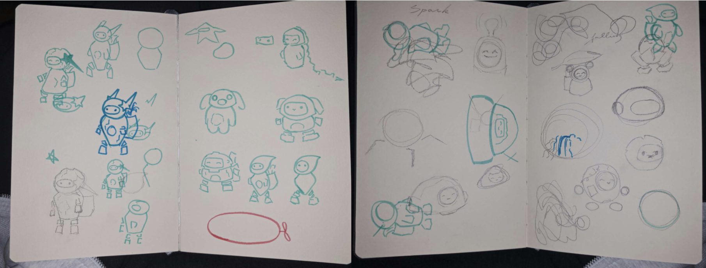
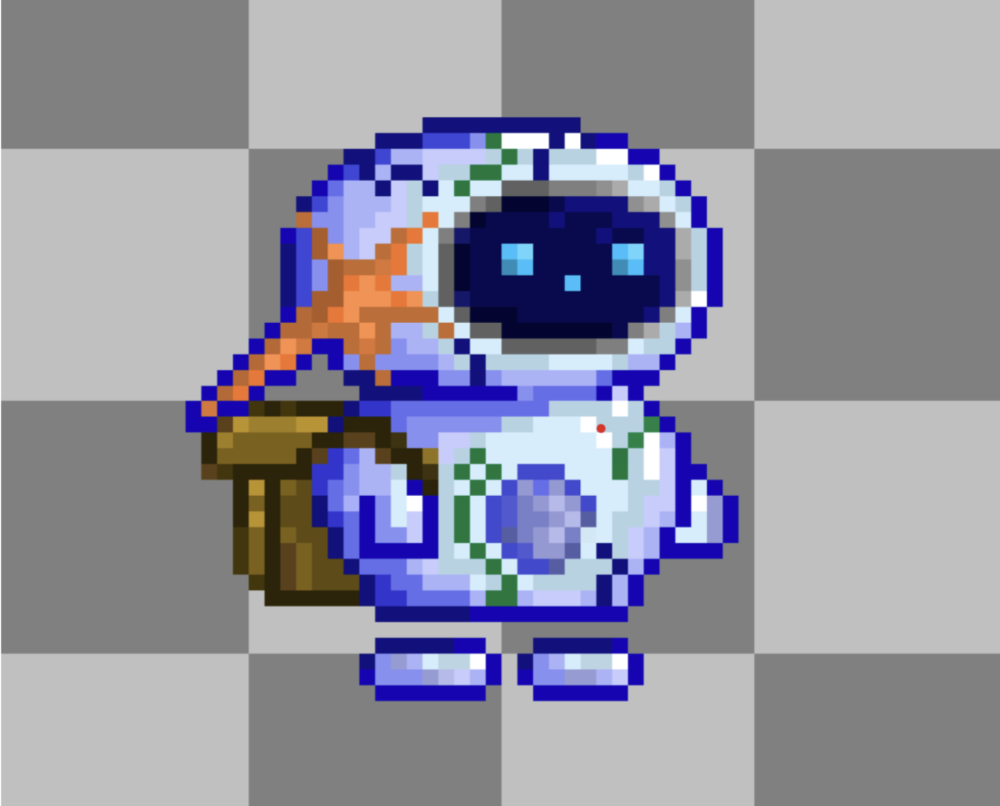
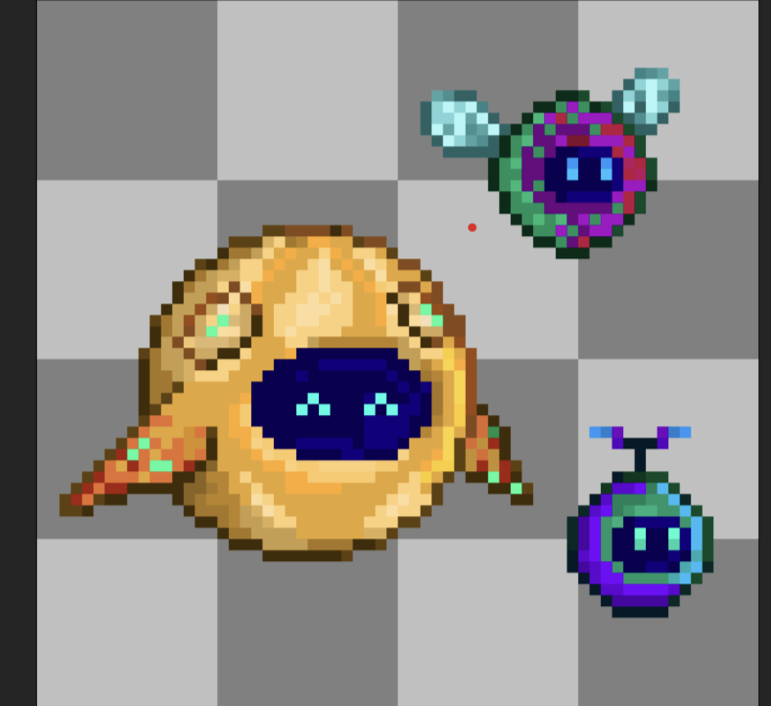

## What I did
- set up unity
- character and movement design
- character movement (idle, walk, jump)
- jump animation

## What worked / didn't
- piskel for animation was good

## Problems and fixes
- idle to walk animation transformation is weird
- jump animation doesn't work in game

## Next
- make repo
- set up github
- fix previously stated problems

## Time spent
- 50h (estimated)

## Screenshots
initial designs

updated robot moving and jumping

